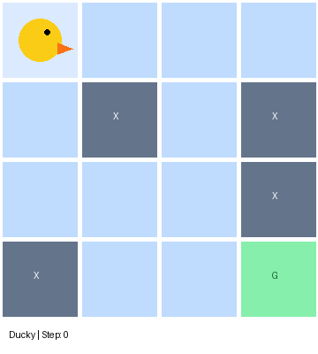
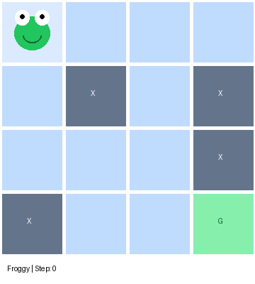

# 🐸 FrozenLake — Q-Learning 🐤

### Same Algorithm. Different Ice.

What happens when two agents learn with exactly the same algorithm, but one of them cannot fully control where it moves?

This project explores that question using **tabular Q-Learning** in Gymnasium's **FrozenLake-v1 (4×4)** environment.

Inspired by the [Hugging Face Deep RL Course — Unit 2](https://huggingface.co/learn/deep-rl-course/unit2/introduction), I extended the original exercise into a comparison of deterministic and stochastic environments, including training analysis, learned policy visualizations, and animated gameplay.

## 🧊 The Experiment

FrozenLake is a small grid-world environment. The agent starts at **S** and must reach **G**, while avoiding holes (**H**) along the way.

The agent receives a reward of **+1 for reaching the goal** and **0 otherwise**.

The interesting part is how the environment responds to actions.

**Non-slippery (`is_slippery=False`)**

When the agent chooses a direction, it moves in that direction (unless blocked by the grid boundary). The outcome is predictable.

**Slippery (`is_slippery=True`)**

The agent still chooses an action, but the environment may execute a different movement.

For example, when the agent selects **UP**, it can move:

- Up — 1/3 probability
- Left — 1/3 probability
- Right — 1/3 probability

These are relative to the chosen direction, so the intended action has only a **33.3% chance** of being executed.

This uncertainty changes the problem: choosing the shortest path is no longer necessarily the safest strategy.

To investigate this, I trained two agents with the **same Q-Learning algorithm and hyperparameters**, changing only the environment's `is_slippery` setting.

## 🐤 Meet Ducky & 🐸 Froggy

<div align="center">
  <table>
    <tr>
      <th align="center">🐤 Ducky — Non-Slippery</th>
      <th align="center">🐸 Froggy — Slippery</th>
    </tr>
    <tr>
      <td align="center">
        
      </td>
      <td align="center">
        
      </td>
    </tr>
  </table>
</div>

**Ducky** operates in a deterministic environment, where movements are predictable.

**Froggy** operates in a stochastic environment, where even a good decision can lead to an unexpected position.

Both GIFs show successful episodes following the agents' learned greedy policies.

## 🧠 How They Learn

Both agents use **tabular Q-Learning**, a model-free, off-policy reinforcement learning algorithm.

Each agent maintains a **Q-Table with 16 states and 4 actions**, estimating the long-term value of taking each action in each state.

During training:

1. The agent chooses actions using an **epsilon-greedy policy**, balancing exploration and exploitation.
2. It receives a reward and observes the next state.
3. It updates the corresponding Q-value using the Bellman optimality target.
4. Epsilon gradually decreases, allowing the agent to rely more on what it has learned.

The Q-Learning update rule is:

```math
Q(s,a) \leftarrow Q(s,a) + \alpha \left[r + \gamma \max_{a'} Q(s',a') - Q(s,a)\right]
```

### Training Configuration

| Hyperparameter | Value |
|---|---:|
| Learning Rate (α) | 0.7 |
| Discount Factor (γ) | 0.95 |
| Initial Epsilon | 1.0 |
| Minimum Epsilon | 0.01 |
| Epsilon Decay | 0.999 |
| Training Episodes | 10,000 |
| Random Seed | 42 |

Both agents use identical hyperparameters. The environment's transition dynamics are the variable being compared.

## 📊 What Happened?

After training, I evaluated both agents over **1,000 episodes**, using greedy action selection without exploration or further Q-Table updates.

| Metric | 🐤 Ducky | 🐸 Froggy |
|---|---:|---:|
| Environment | Deterministic | Stochastic |
| Last 100 Training Episodes | 99% | 63% |
| Evaluation Success Rate | **100%** | **73.7%** |
| Mean Reward | 1.000 | 0.737 |
| Average Steps per Episode | 6.00 | 40.57 |
| Average Steps in Successful Episodes | 6.00 | 36.87 |

### What Do These Results Tell Us?

**Ducky** learned a reliable 6-step route to the goal. Since its movements are predictable, the same greedy policy succeeds every time in the evaluation.

**Froggy**, on the other hand, faces uncertainty even after training. Its actions can produce different movements, making some episodes much longer and others unsuccessful.

The difference is not simply that one agent learned and the other did not. They face different transition dynamics, so the same decision-making algorithm produces different behavior and performance.

**An important distinction:** Training curves show how learning progresses, while evaluation measures how the learned policy performs after training.

These results were obtained on the same FrozenLake map used during training, not on previously unseen maps.

## 🔍 What's Inside the Notebook?

Beyond training two agents, the notebook includes:

- Training success curves with moving averages
- Epsilon decay visualization
- Q-value heatmaps
- Learned greedy policy visualizations
- Animated gameplay for Ducky and Froggy
- Independent evaluation over 1,000 episodes

The visualizations help explain not only **how often an agent succeeds**, but also **how its learned behavior differs between environments**.

## 🚀 Run the Experiment

Open the notebook in Google Colab and run the cells in order:

**[FrozenLake_Q_Learning.ipynb](FrozenLake_Q_Learning.ipynb)**

The notebook contains the training, evaluation, plotting, and animation code.

## 🤗 Pretrained Q-Tables

Want to try the trained agents without repeating the training process?

Both Q-Tables are available on Hugging Face:

**[🐤🐸 FrozenLake-Q-Learning — Hugging Face](https://huggingface.co/zeynpakn/FrozenLake-Q-Learning)**

The repository includes:

```text
models/
├── ducky_q_table.npy
└── froggy_q_table.npy
```

## 💡 Final Takeaway

**The environment matters as much as the learning algorithm.**

In deterministic FrozenLake, Ducky can consistently follow the shortest route.

In slippery FrozenLake, Froggy must account for uncertainty and the possibility that an intended action will not happen as expected.

The experiment demonstrates why reinforcement learning is not just about selecting actions with high rewards, but about learning which decisions work best under the environment's actual dynamics.

---

<p align="center">
  <i>🐤 Ducky follows the rules. Froggy negotiates with physics. 🐸</i>
</p>

<p align="center">
  <sub>Inspired by the Hugging Face Deep Reinforcement Learning Course — Unit 2</sub>
</p>
